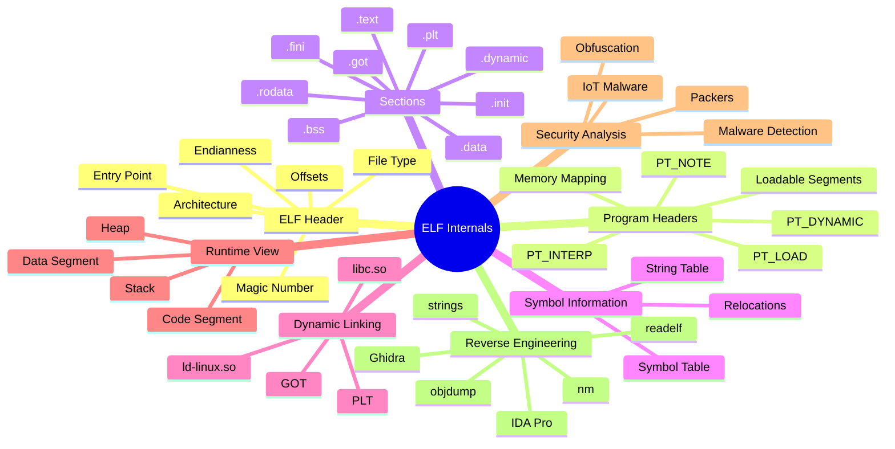

    

        <a href="https://wiki.osdev.org/ELF">
        

           
ELF FILE MAP

          
        

        </a>
    

# **`Awesome`** [ELF](https://wikipedia.org/wiki/Executable_and_Linkable_Format) (Executable and Linkable [Format](https://gabi.xinuos.com/)) Internals 

 

    
    &nbsp;
    
    &nbsp;
    
    

## 📖 Contents
- [My Other Awesome Lists](#my-other-awesome-lists)
- [Contributing](#contributing)
- [Contributors](#contributors)

## ELF X-Ray

## Miscellaneous Tools

##

### My Other Awesome Lists
You can access the my other awesome lists [here](https://cyberthreatdefence.com/my_awesome_lists)

### Contributing
[Contributions of any kind welcome, just follow the guidelines](contributing.md)!

### Contributors
[Thanks goes to these contributors](https://github.com/cybersecurity-dev/awesome-elf-internals/graphs/contributors)!

### License

[🔼 Back to top](#awesome-elf-executable-and-linkable-format-internals-)
